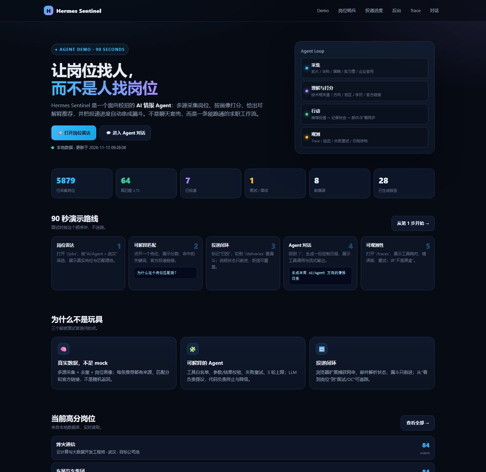
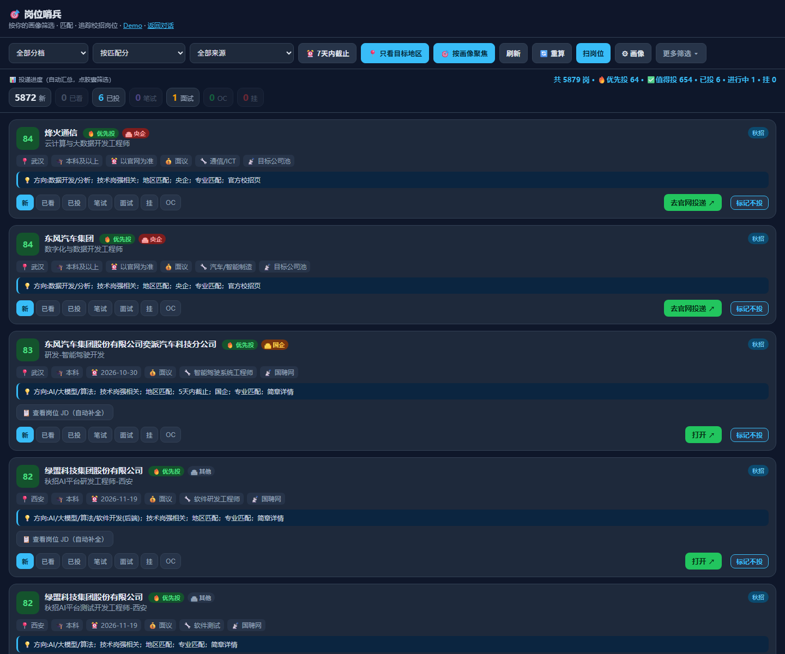

# Hermes Sentinel — 多渠道 AI 情报助手

> **让信息找人，而不是人找信息。**
> 在 Email / 手机浏览器上，像聊天一样让 AI 帮你搜信息、生成情报日报、管理长期记忆、按需操控电脑。
>
> *A multi-channel AI intelligence agent — FastAPI + DeepSeek gateway, pluggable async adapters, RAG long-term memory, and a live job radar dashboard. Information finds you.*

Hermes Sentinel 是一个面向**求职 AI/Agent 岗位**的个人信息情报助手：多渠道接入、可插拔的异步适配器、RAG 长期记忆、主动情报推送、以及一个可演示的 Web 后台。强调**工程成熟度**而非功能堆砌——异步 SDK 接入层、结构化渲染、记忆系统、模块化可发布包，都是可直接写进简历的硬资产。

## 🚀 90 秒 Demo

> 启动后打开 **`/demo`**：一页看清「真实岗位数据 → 可解释匹配 → 投递漏斗 → Agent 对话 → Trace」。
> 面试时按 [`DEMO.md`](DEMO.md) 的 5 步讲，不迷路。



岗位雷达（真实数据）：



当前本地演示库：**5,879 条岗位、8 个来源、64 个 ≥75 分高匹配**；数据来自武大/华科就业网、国聘、实习僧、企业官网等。

## 🎯 核心能力

| 能力 | 说明 | 触发方式 |
|------|------|---------|
| 💬 智能对话 | DeepSeek 推理，带结构化输出与思维链回传 | 直接发消息 |
| 🛰️ 联网情报 | Web 搜索（Bing + DuckDuckGo 容错）、GitHub、HackerNews、arXiv | 「搜一下 MCP agent」「最新论文」 |
| 📊 AI 日报 | 结构化 AI 情报日报（HTML 卡片，手机友好） | 「发日报」「推日报」 |
| 💼 求职专题 | 大厂动态 / 招聘信号 / 可投递方向专题报告 | 「求职报告」「岗位报告」 |
| 🧠 RAG 长期记忆 | TF-IDF 向量库持久化，每次对话**自动注入**上下文 | 「记住我的简历…」 |
| 💻 本机操控 | 执行命令（白名单安全限制）、读写文件 | 「桌面有什么文件」 |
| 📡 按需推送 | 在邮件里喊一声，HTML 情报邮件推到手机 | 邮件发「发日报」 |
| ⏰ 每日定时情报 | 每天 08:30 自动「扫岗位 + 生成 AI 日报 + 推邮件」，错过开机窗口自动补发 | 无需操作 / `HERMES_DAILY_PUSH_HOUR` 可调 |
| 👤 画像中心 | 结构化用户画像（毕业/城市/方向/技能）可视化编辑，改完立即对 Agent 生效 | 浏览器开 `/dashboard` |
| 📈 可视化后台 | 统一导航 + SVG 图表（投递漏斗 / 7 日趋势 / 工具调用排行）+ 对话 / 知识库 / 日报存档 | 浏览器开 `/dashboard` |
| 🎯 秋招哨兵 | 按地区/方向/学历/院校/批次筛选匹配校招岗位，卡片流 + 投递状态追踪 | 「扫岗位」「查秋招」 / 浏览器开 `/jobs` |

## 🏗️ 架构

```
Email (Caspian) ──┐
                  ├──→ hermes_caspian (异步适配器) ──┐
手机浏览器 ───────┤                                    ├──→ Agent Core ──→ DeepSeek API
  (FastAPI)       └──→ static/index.html, dashboard ──┘        │
                                                              │   15 个工具 (web / 报告 / RAG / 岗位 / 操控)
RAG 长期记忆 ───── hermes_rag (自动注入) ─────────────────────┘
                                                              └── reports 表 (日报存档)
```

- **接入层**：`hermes_caspian`（可发布 pip 包，异步 Email 接入）+ FastAPI Web UI
- **核心**：DeepSeek（`deepseek-v4-flash`，走代理网关）
- **工具（15 个）**：`web_search` / `search_github` / `hackernews_top` / `arxiv_latest` / `ai_daily_report` / `ai_job_report` / `job_sentinel_scan` / `job_sync_email` / `kb_add` / `kb_search` / `kb_stats` / `execute_command` / `read_file` / `write_file` / `profile_update`
- **记忆双轨**：SQLite 短期对话历史 + `hermes_rag` 长期可检索知识库
- **渲染**：`report_html.py` 数据驱动，输出手机 QQ 邮箱兼容的 table 布局 + 内联 CSS
- **秋招哨兵**：`job_sentinel/`，按用户画像筛选匹配校招岗位，卡片流前端 `static/jobs.html`（PWA）
  - 采集 `sources/`（适配器模式，任一源失效不影响主流程），按用户画像优先级：**武汉大学就业网（主源·岗位级富矿，逆向 API 按国标区划码武汉 420100/湖北 420000 精准过滤，返回岗位名+城市+学历+专业+薪资+JD全文+网申直链）** → 华中科技大学就业网（武汉本地校招补充） → 国聘网（全国央国企，按城市关键词抓校招、社招拦截） → 实习僧（实习/外企补充，已识别 55 条外企） → ResumeMaker 雷达 / offer多多 / 目标公司池（公司级补充） → 本地种子。浏览器扩展捕获牛客/BOSS/大厂官网等（见下）。
  - 标签体系：每条岗位带 `enterprise_type`（央企/国企/事业单位/外企/民企/其他，归一化自来源 nature 字段）与 `exam_free`（免笔试/有笔试/未知，从标题+JD 检测；存量 JD 少多为未知，随扫描累积）。看板可按企业性质、是否免笔试胶囊筛选。
  - 匹配 `matcher.py`：三级过滤（行业黑名单 → **技术相关度** → 硬条件，含学历枚举「本科,硕士」解析与「其他」批次放行），打分权重 技术 50 / 方向 25 / 地区 12 / 央国企 8 / 学历 3 / **链接 官方网申5·简章详情4·官方校招页2·搜索直达1**
  - 投递链接精准化：采集源直给的「官方网申」（企业自建表单 jsj.top/wjx/moka/campus…）与「简章详情」（武大就业网招聘简章页 `xsjy.whu.edu.cn/.../show`）为**受信直链**，优先于公司首页；`_pick_apply_url` 只认真正的网申域名，找不到就回退简章页，**绝不拿公司首页凑数**。非受信源才降级 官方校招页 → 搜索直达，保证每张卡片点过去就是投递页/简章，不用自己找
  - 存储 `store.py`：SQLite + 投递状态追踪；清理历史噪声时**保护已投/笔试/面试记录**
  - **投递进度自动同步** `email_sync.py`：把智联/BOSS/企业聘用等**邮件自动解析**成岗位状态变更并回写库，无需手动标记。两条接入路径：① **QQ 邮箱自动转发**——在 QQ 邮箱设收信规则，把含「投递/笔试/面试/offer/未通过」的邮件转发到 Hermes 的 Caspian 地址（`agt-...@agents.trycaspianai.com`），转发到达即识别→解析→回写→回推汇总到手机；② **手动粘贴**——把邮件正文发给 Hermes 说「解析这封邮件」同样生效。`parse_delivery_email` 按状态词前 40 字窗口取最靠近的公司（避免盘点邮件串公司），`挂` 只用明确否定词（「感谢关注」等客套结尾不算拒信），状态按漏斗只前进（挂可覆盖）。投递看板 `static/jobs.html` 顶部实时汇总各状态数量，点胶囊筛选

### 📧 投递邮件自动同步（一键设置）

让 Hermes 自动知道你投到哪了，不用手动标记：

1. 打开 **QQ 邮箱 → 设置 → 收信规则**（或「自动转发」），新建规则：
   - 条件：邮件主题/正文包含 `投递` 或 `笔试` 或 `面试` 或 `offer` 或 `未通过`
   - 动作：**自动转发** 到 Hermes 的 Caspian 地址 `agt-44bab13d0748dae0a89da5c8-9323f0@agents.trycaspianai.com`
2. 此后每收到一封投递确认/笔试/面试/offer/拒信，Hermes 自动解析公司名+状态，回写到「岗位哨兵」对应岗位，并把更新汇总**回推到手机**。
3. 不想设转发？直接把邮件正文粘贴给 Hermes，说「解析这封邮件」即可。

> 解析规则：识别「投递成功/简历已查收→已投」「笔试/测评→笔试」「面试邀请→面试」「录用/offer→OC」「未通过/落选→挂」；状态按漏斗只前进（挂可覆盖）；同一公司多封邮件折叠为最终状态。库里没有的公司会提示先「扫岗位」补充来源。

### 🧩 浏览器扩展自动捕获网申（不发邮件也能记）

针对「网申只显示提交成功页、不发确认邮件」的场景，用浏览器扩展在提交成功页直接上报：

1. **安装**：Chrome/Edge 打开 `chrome://extensions` → 右上角「开发者模式」→「加载已解压的扩展程序」→ 选择 `job_sentinel/extension/` 目录。
2. **一键捕获**（主路径）：网申提交成功后点扩展图标 → popup 自动提取当前页公司名+岗位 → 确认点「记录本次投递」即写入（状态=已投）。
3. **半自动通知**：扩展后台监听 URL 含 `success/submit/apply/完成/提交成功` 且来自招聘域的页面，自动弹通知；**点一下通知**即提取+上报，比开 popup 省一步（不会无确认自动写库，避免误报）。
4. **连接**：扩展默认连 `http://127.0.0.1:9866`、Token `hermes-ext-2026`（与服务端 `EXT_TOKEN` 一致，可在 popup「设置」或 `.env` 改）。

服务端新增 `POST /api/extension/apply`（Bearer 鉴权）：收到 `{company,title,url}` 后用 `match_company` 归位到库内岗位并置「已投」，库内无匹配则新建 `source=浏览器扩展` 记录；`server.py` 已加 CORS 允许 `chrome-extension://` 跨域。

## 🚀 快速开始

### 1. 安装依赖

```bash
pip install -r requirements.txt
```

### 2. 配置密钥

在项目根目录创建 `.env`，填入：

```
CASPIAN_API_KEY=你的_caspian_key
DEEPSEEK_API_KEY=你的_deepseek_key
```

> `.env` 已被 `.gitignore` 排除，不会进版本库。

### 3. 启动

```bash
python server.py
```

然后：
- **演示入口（推荐）**：`http://localhost:{PORT}/demo`
- 电脑浏览器：`http://localhost:{PORT}`
- 手机浏览器：`http://电脑IP:{PORT}`
- 邮件渠道：对 Caspian 邮箱发「发日报」，HTML 情报邮件推到手机

### 4. （可选）RAG 长期记忆

```
对助手说：「记住我的简历：我是 2027 届数据科学本科…」
之后任意对话，助手自动带着你的简历/项目经历作答
```

升级稠密向量（语义检索更准，需联网下载模型）：

```bash
pip install sentence-transformers
set HERMES_EMBEDDING=dense
```

## 📁 项目结构

```
hermes-sentinel/
├── server.py            # 核心服务 (FastAPI + Caspian + DeepSeek + 14 工具)
├── report_html.py       # 数据驱动 HTML 渲染（日报/求职报告）
├── static/
│   ├── demo.html        # 90 秒演示首页（Demo Hub）
│   ├── index.html       # Web 聊天 UI
│   ├── jobs.html        # 岗位雷达 / 投递漏斗
│   ├── deliveries.html  # 投递进度
│   ├── traces.html      # 可观测性
│   └── dashboard.html   # 可视化后台（对话/知识库/工具/日报存档）
├── docs/                # README 截图
├── DEMO.md              # 90 秒演示脚本 + 讲稿
├── hermes_caspian/      # 可发布异步 Email 接入层（pip 包）
├── hermes_rag/          # 可插拔 RAG 引擎（TF-IDF / 可选稠密，持久化）
├── requirements.txt
├── Dockerfile           # 通用容器化部署
├── .dockerignore
├── .env.example         # 环境变量模板
├── DEPLOY.md            # 部署指南
├── 启动.bat             # Windows 一键启动
└── README.md
```

> 敏感与运行时文件（`.env`、`hermes.db`、`kb/`、`cloudflared.exe`、`__pycache__`）不进版本库，也不随项目分发。

## 🔒 安全

- `execute_command` 受**命令白名单**约束：仅放行常用只读/开发命令，拦截 `rm`/`del`/`format`/`shutdown`/`powershell` 及 fork bomb 等危险指令。
- 所有密钥走环境变量 / `.env`，不硬编码。

## 🧪 回归与验证

- `test_regression_2026-09-04.py`、`e2e_mock_test.py` 是手工回归脚本，**不是 pytest 套件**。
- 当前仓库没有完整 CI；不要把“15+12 pytest / GitHub Actions 全绿”写进简历，除非你补上并跑通。
- 本次 Demo 已验证：`/health` 200、`/demo` 200、`/api/demo/summary` 200。
- 下一步优先补：`tests/` + `pytest` + GitHub Actions，把“可回归”做实。

## 🔗 我的其他项目

- [data-analysis-agent](https://github.com/Hong-lf0719/data-analysis-agent) — LangGraph 驱动的数据分析 Agent（`SKILL.md` 开放标准、60 项测试、TDD for Skills 校验规则）。
